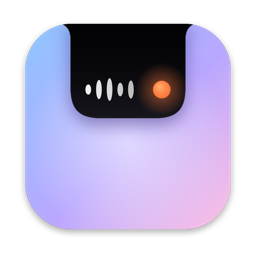
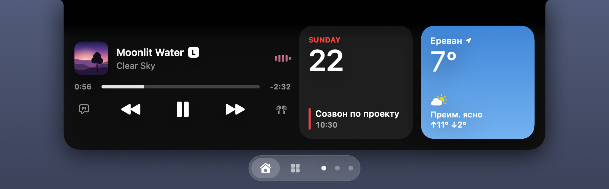
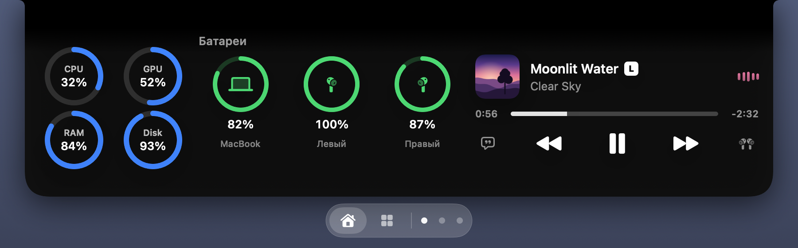

<p align="center">
  
</p>

<h1 align="center">Isle</h1>

<p align="center">
  Dynamic Island для выреза MacBook и экран блокировки со Spotify.<br>
  Плеер, виджеты, буфер обмена, трей файлов и статус AI-агентов прямо в чёлке.
</p>

<p align="center">
  <a href="../../releases/latest"><b>Скачать Isle</b></a> · macOS 15+ · Apple Silicon и Intel · бесплатно, MIT
</p>


## Возможности

### Экран блокировки
- Обложка трека на весь экран, большие часы и плеер прямо на экране блокировки.
- **Clock Depth**: объект с обложки встаёт поверх часов, как на iPhone.
- Синхронизированные тексты песен ([LRCLIB](https://lrclib.net)).
- Точки ввода пароля, чтобы видеть, что печатаешь.
- Редактор: шрифт и цвет часов, стеклянные часы, ряд виджетов (погода, календарь, батареи, курсы, агенты), стиль плеера, фон.


### Чёлка
Наведи на вырез, и он раскроется в полку с виджетами. Колесом или свайпом листаются страницы, каждую можно собрать под себя.



| Виджет | Что делает |
|---|---|
| Плеер | Spotify: обложка, прогресс, управление, выбор устройства вывода, тексты |
| Календарь, погода | события на сегодня, погода по [Open-Meteo](https://open-meteo.com) |
| Система, батареи | CPU, GPU, RAM, диск, батарея Mac, AirPods и других Bluetooth-устройств |
| Микшер | громкость отдельно для каждого приложения |
| Буфер обмена | история копирования, ⌥⇧V открывает выбор где угодно |
| Трей | перетащи файлы на чёлку, они полежат там, пока не понадобятся |
| Курсы | валюты и крипта, ⌥⇧C открывает конвертер как в Spotlight |
| Агенты | что делает Claude Code прямо сейчас, правки по файлам, лимиты плана |




### И ещё
- **HUD громкости и яркости** в стиле острова вместо системного.
- **Агенты**: пока Claude Code работает, в чёлке живёт индикатор, а когда он закончил или ждёт ответа, показывается уведомление. Можно подключить Isle к Claude Code как MCP-сервер (каждый инструмент включается отдельно).
- **Удаление фона**: перетащи картинку на чёлку, получишь PNG без фона в буфере.
- **Чистка приложений**: удаляет приложение вместе с его хвостами в Library (в Корзину).


## Установка

1. Скачай `Isle-x.y.z.dmg` из [Releases](../../releases/latest).
2. Открой DMG и перетащи **Isle** в **Applications**.
3. Запусти Isle из Applications. В строке меню появится значок острова, через него все настройки.

> [!NOTE]
> Если macOS пишет, что не может проверить приложение: **Системные настройки → Конфиденциальность и безопасность**, внизу **«Всё равно открыть»**. Это бывает со сборками без нотаризации Apple.

### Разрешения
Isle спрашивает их по мере надобности, ничего не нужно включать заранее.

| Разрешение | Зачем |
|---|---|
| Автоматизация → Spotify | читать текущий трек и управлять воспроизведением |
| Универсальный доступ | HUD громкости и яркости (медиа-клавиши), точки ввода пароля |
| Календари | события в виджете календаря |
| Геолокация | погода там, где ты (координаты округляются до ~1 км) |
| Bluetooth | заряд AirPods и других устройств |
| Запись звука системы | микшер громкости по приложениям |

## Горячие клавиши

| | |
|---|---|
| ⌥⇧V | история буфера обмена |
| ⌥⇧C | конвертер валют |

## Приватность
Isle не собирает аналитику и ни с кем не делится данными. В сеть он ходит только за этим:
- тексты песен: `lrclib.net` (название и исполнитель трека);
- погода: `api.open-meteo.com` (округлённые координаты);
- курсы валют: `cdn.jsdelivr.net` / `currency-api.pages.dev`;
- лимиты Claude: `api.anthropic.com`, только если подключён Claude Code. Используется его же локальный токен из Связки ключей, и никуда больше он не уходит.

Хуки Claude Code и MCP подключаются только вручную из меню Isle, и так же отключаются.

## Сборка из исходников

Нужны Xcode 26+ и [XcodeGen](https://github.com/yonaskolb/XcodeGen).

```bash
brew install xcodegen
git clone https://github.com/danchetin/isle.git && cd isle
./scripts/install.sh      # Release → /Applications/Isle.app и запуск
```

Для своей сборки поменяй `DEVELOPMENT_TEAM` в `project.yml` на свой Team ID.

Скрипт `./scripts/release.sh` собирает DMG в `build/dist`. Если в Связке ключей есть сертификат **Developer ID Application** и профиль `notarytool`, он подписывает и нотаризует DMG (подробности в шапке скрипта).

<details>
<summary>Для разработки</summary>

```bash
xcodegen generate
xcodebuild -project Isle.xcodeproj -scheme Isle -configuration Debug -derivedDataPath build build
```

Debug-сборка не запускается рядом с установленной копией и не трогает шимы хуков и MCP. Интерфейс удобно проверять без блокировки экрана:

| Флаг | Что делает |
|---|---|
| `--snapshot <dir> [--art cover.jpg]` | рендерит экраны в PNG (`ISLE_SAMPLE=1` даёт только демо-данные) |
| `--uitest` | кликает по редактору полки в невидимом окне |
| `--probe` | поля Spotify через AppleScript |
| `--remove-bg <in> <out>` | удаление фона |
| `--clean-scan <app>` | пробный прогон чистки |
| `--convert <запросы…>` | парсер конвертера на живых курсах |
| `--hook <source>` / `--mcp` | форвардер хуков / MCP-сервер на stdio |

| Часть | Где | Как |
|---|---|---|
| Spotify | `Spotify/` | уведомление `PlaybackStateChanged` + AppleScript, позиция интерполируется |
| Экран блокировки | `LockScreen/SkyLight.swift` | приватный SkyLight space над экраном блокировки |
| Clock Depth | `Media/ArtworkProcessor.swift` | маска переднего плана из Vision |
| Чёлка | `Notch/`, `Shelf/` | неактивирующая панель над вырезом |
| Агенты | `Agents/` | хуки Claude Code → локальный Unix-сокет, MCP на stdio |
| Микшер | `Audio/` | CoreAudio process taps |

</details>

## Ограничения
- Экран блокировки и яркость работают через приватные API macOS (SkyLight, DisplayServices). Обновление системы может что-то сломать.
- Из музыкальных сервисов поддерживается только Spotify.
- Интерфейс только на русском.

## Благодарности
- [SkyLightWindow](https://github.com/Lakr233/SkyLightWindow) от Lakr Aream: техника окна над экраном блокировки (MIT, см. [THIRD_PARTY_NOTICES.md](THIRD_PARTY_NOTICES.md)).
- [LRCLIB](https://lrclib.net), [Open-Meteo](https://open-meteo.com), [fawazahmed0/exchange-api](https://github.com/fawazahmed0/exchange-api).

Isle не связан со Spotify, Apple или Anthropic. Названия принадлежат их владельцам.

## Лицензия
[MIT](LICENSE)
