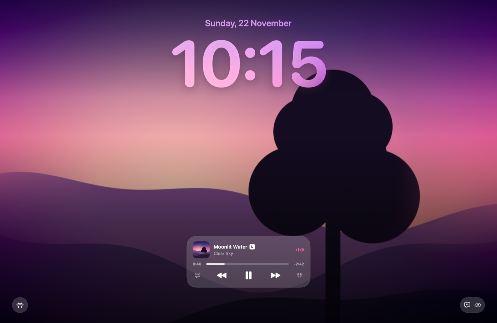
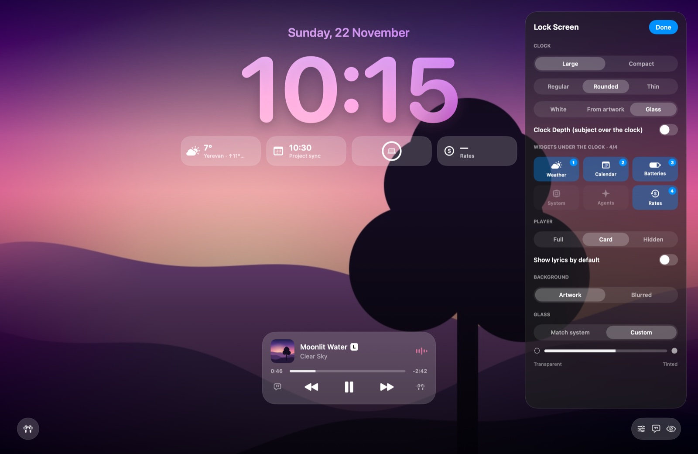
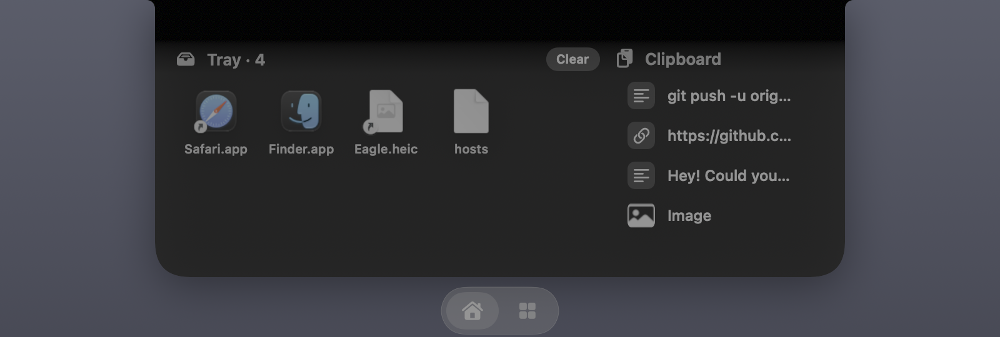
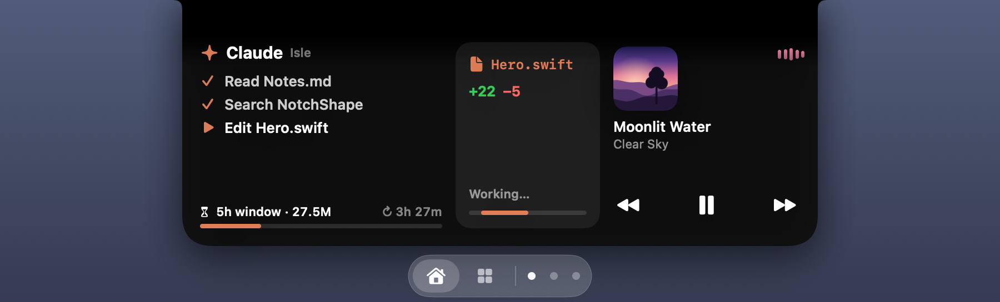

<p align="center">
  
</p>

<h1 align="center">Isle</h1>

<p align="center">
  A Dynamic Island for the MacBook notch, plus a Spotify lock screen.<br>
  Player, widgets, clipboard history, a file tray and live AI-agent status, right in the notch.
</p>

<p align="center">
  <a href="../../releases/latest"><b>Download Isle</b></a> · macOS 15+ · Apple Silicon & Intel · free, MIT
  <br>
  <a href="README.ru.md">Русский</a>
</p>



## Features

### Lock screen
- Full-screen artwork, a big clock and a player, right on the lock screen.
- **Clock Depth**: the subject of the cover art steps in front of the clock, like on iPhone.
- Synced lyrics from [LRCLIB](https://lrclib.net).
- Dots while you type your password, so you can see it's being entered.
- Editor: clock font and color, a glass clock, a widget row (weather, calendar, batteries, rates, agents), player style, background.



### Notch
Hover the notch and it opens into a shelf of widgets. Scroll or swipe through pages, and lay out each one the way you like.


| Widget | What it does |
|---|---|
| Player | Spotify: artwork, progress, controls, output device, lyrics |
| Calendar, Weather | today's events, weather from [Open-Meteo](https://open-meteo.com) |
| System, Batteries | CPU, GPU, RAM, disk, the Mac's battery, AirPods and other Bluetooth devices |
| Volume | per-app volume |
| Clipboard | copy history, ⌥⇧V opens the picker anywhere |
| Tray | drop files on the notch and they wait there until you need them |
| Rates | currencies and crypto, ⌥⇧C opens a Spotlight-style converter |
| Agents | what Claude Code is doing right now, per-file edits, plan limits |




### And also
- **Volume and brightness HUD** in the island's style instead of the system one.
- **Agents**: while Claude Code works, a live indicator sits in the notch. When it finishes or needs your input, you get a notification. Isle can also be added to Claude Code as an MCP server (each tool is opt-in).
- **Background removal**: drop an image on the notch to get a PNG without its background on the clipboard.
- **App uninstaller**: removes an app together with its leftovers in Library (to the Trash).



## Install

1. Download `Isle-x.y.z.dmg` from [Releases](../../releases/latest).
2. Open the DMG and drag **Isle** into **Applications**.
3. Launch Isle from Applications. An island icon appears in the menu bar, and everything is configured from there.

### “Isle can't be opened” / “Apple could not verify Isle”
Builds that aren't notarized by Apple are blocked by Gatekeeper on first launch. Either:

- **Terminal (fastest):** type `xattr -cr ` (with the trailing space), drag **Isle** from Applications into the Terminal window to paste its path, and press Return:
  ```bash
  xattr -cr /Applications/Isle.app
  ```
- **System Settings:** try to open Isle once, then go to **Privacy & Security**, scroll down and click **Open Anyway**.

### Permissions
Isle asks for each one when it's first needed. Nothing needs to be turned on in advance.

| Permission | Why |
|---|---|
| Automation → Spotify | read the current track and control playback |
| Accessibility | volume/brightness HUD (media keys), password dots |
| Calendars | events in the calendar widget |
| Location | weather where you are (coordinates rounded to ~1 km) |
| Bluetooth | battery level of AirPods and other devices |
| System audio recording | per-app volume mixer |

## Shortcuts

| | |
|---|---|
| ⌥⇧V | clipboard history |
| ⌥⇧C | currency converter |

## Language
English and Russian. Isle follows the system language. To change it, use **Language** in the menu bar menu.

## Privacy
Isle has no analytics and shares nothing with anyone. It goes online only for:
- lyrics: `lrclib.net` (track title and artist);
- weather: `api.open-meteo.com` (rounded coordinates);
- exchange rates: `cdn.jsdelivr.net` / `currency-api.pages.dev`;
- Claude limits: `api.anthropic.com`, only when Claude Code is connected. Isle uses Claude Code's own local token from the Keychain and sends it nowhere else.

Claude Code hooks and the MCP server are only connected when you turn them on in the Isle menu, and you can turn them off there too.

## Build from source

Requires Xcode 26+ and [XcodeGen](https://github.com/yonaskolb/XcodeGen).

```bash
brew install xcodegen
git clone https://github.com/danchetin/isle.git && cd isle
./scripts/install.sh      # Release build → /Applications/Isle.app, then launch
```

For your own build, set `DEVELOPMENT_TEAM` in `project.yml` to your Team ID.

`./scripts/release.sh` builds a universal DMG into `build/dist`. With a **Developer ID Application** certificate and a `notarytool` profile in the Keychain, it signs and notarizes it too (see the script's header).

<details>
<summary>Development</summary>

```bash
xcodegen generate
xcodebuild -project Isle.xcodeproj -scheme Isle -configuration Debug -derivedDataPath build build
```

A Debug build won't run next to the installed copy and never takes over the hook / MCP shims. You can check the UI without locking the screen:

| Flag | What it does |
|---|---|
| `--snapshot <dir> [--art cover.jpg]` | renders screens to PNG (`ISLE_SAMPLE=1` = demo data only, `-AppleLanguages "(en)"` picks the language) |
| `--uitest` | clicks through the shelf editor in an invisible window |
| `--probe` | Spotify fields via AppleScript |
| `--remove-bg <in> <out>` | background removal |
| `--clean-scan <app>` | uninstaller dry run |
| `--convert <queries…>` | converter parser against live rates |
| `--hook <source>` / `--mcp` | hook forwarder / MCP stdio server |

UI strings are English in code; Russian lives in `Isle/Resources/Localizable.xcstrings`.

| Part | Where | How |
|---|---|---|
| Spotify | `Spotify/` | `PlaybackStateChanged` notification + AppleScript, position interpolated |
| Lock screen | `LockScreen/SkyLight.swift` | private SkyLight space above the lock screen |
| Clock Depth | `Media/ArtworkProcessor.swift` | Vision foreground mask |
| Notch | `Notch/`, `Shelf/` | non-activating panel over the notch |
| Agents | `Agents/` | Claude Code hooks → local Unix socket, MCP over stdio |
| Volume mixer | `Audio/` | CoreAudio process taps |

</details>

## Limitations
- The lock screen and brightness rely on private macOS APIs (SkyLight, DisplayServices), so a system update can break them.
- Spotify is the only supported music service.
- The currency converter treats amounts without a currency as Armenian dram (AMD).

## Credits
- [SkyLightWindow](https://github.com/Lakr233/SkyLightWindow) by Lakr Aream: the technique for a window above the lock screen (MIT, see [THIRD_PARTY_NOTICES.md](THIRD_PARTY_NOTICES.md)).
- [LRCLIB](https://lrclib.net), [Open-Meteo](https://open-meteo.com), [fawazahmed0/exchange-api](https://github.com/fawazahmed0/exchange-api).

Isle isn't affiliated with Spotify, Apple or Anthropic. All names belong to their owners.

## License
[MIT](LICENSE)
